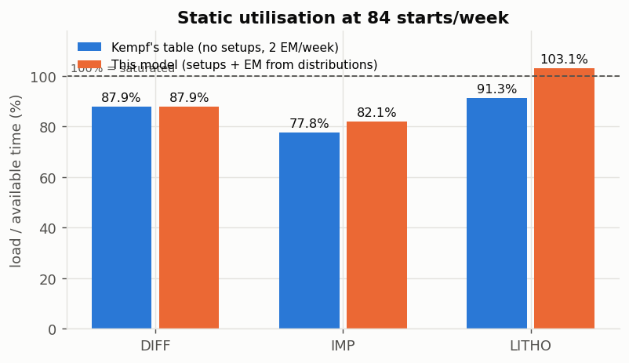
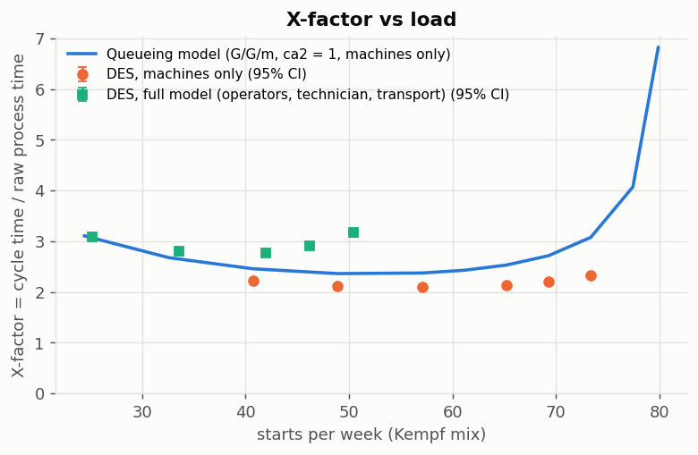
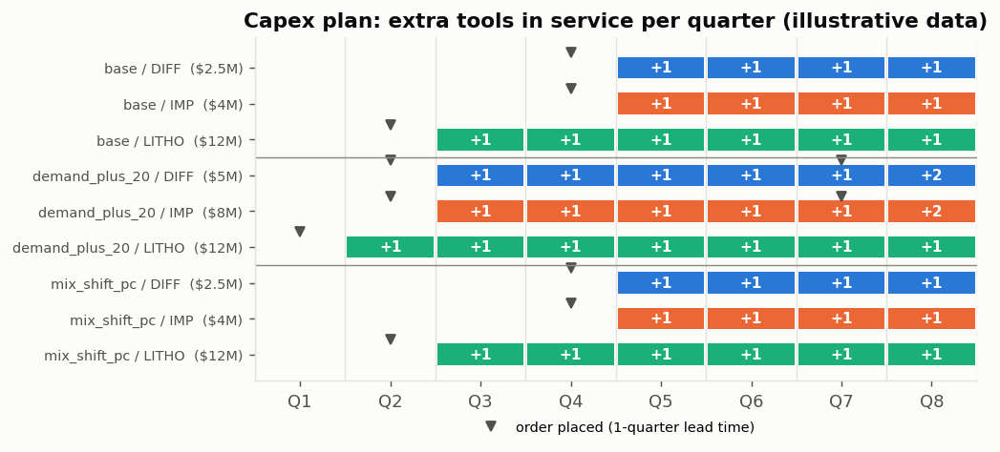
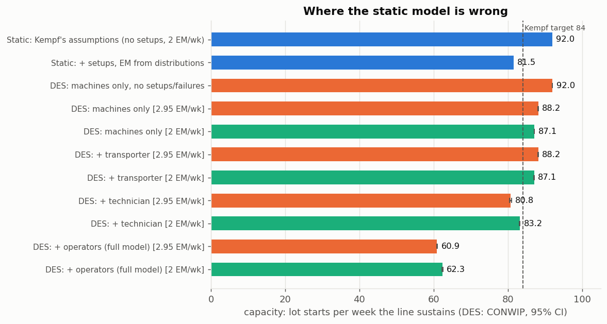

# fab-capacity-planner

Capacity planning for a small **re-entrant semiconductor fab**, done four ways and checked against each
other, plus a tool-calling agent that answers capacity questions from numbers the models produce.

1. **Static capacity model** - load, availability, utilisation, bottleneck, maximum starts, product-mix sensitivity.
2. **Queueing approximation** - G/G/m (Kingman / Sakasegawa form) cycle time per tool group and an X-factor curve.
3. **Capital-and-staffing MILP** (PuLP + CBC) - which tools to buy and which operators/technicians to hire, and
   when, over 8 quarters; checked by independent code and re-run in the simulation.
4. **Discrete-event simulation** (SimPy) - batching, setups, PM, failures, operators, technicians, transport;
   three dispatching rules; 10 replications with 95 % confidence intervals.
5. **Debottlenecking** - what-ifs ranked by throughput gain per dollar, by the static model and by the simulation.
6. **Agent** - a local LLM (Ollama) or a deterministic keyword router calls the models; a validator rejects
   an answer if it contains a number that cannot be traced to a computed tool value (or, for echoed
   arguments, to the user's question). What it does and does not guarantee is listed in section 6.

The point of doing it four ways is the disagreements: section 4 shows where the spreadsheet-style capacity
model is wrong and by how much, and section 3 shows where the capex plan disagrees with the simulation.

## Reference fab: the Intel Mini-Fab

The fab is the *Intel Five-Machine Six-Step Mini-Fab*, a teaching case by Karl Kempf (Intel; Intel/ASU report,
1994, as cited by van den Berk). All parameters were taken from the archived specification and cross-checked
against two independent write-ups ([docs/sources.md](docs/sources.md) S1-S3):

| | Diffusion (DIFF) | Ion implant (IMP) | Lithography (LITHO) |
|---|---|---|---|
| Machines | Ma, Mb | Mc, Md | Me |
| Steps (run min) | S1 (225), S5 (255) | S2 (30), S4 (50) | S3 (55), S6 (10) |
| Load / unload min | 20 / 40 | 15 / 15 | 10 / 10 |
| Batching | 3 lots, mixing rules, max 1 test lot | - | - |
| Setups | - | - | 5 / 10 / 12 min (product / step / both change) |
| PM | 75 min per day | 120 min per shift | 30 min per shift |
| Failures | - | "once each half week", 50 +/- 26 h after a repair, repair 6-8 h, lot scrapped | - |

Route for every product: S1 → S2 → S3 → S4 → S5 → S6 (each tool group visited twice).
Weekly starts: 51 lots Pa, 30 lots Pb, 3 test lots TW (84 total). Two operators, one technician, one transporter.

The **planning layer** (`data/planning.json`: tool prices, labour costs, lead times, demand forecast, an extra
product **Pc** with one more litho/implant loop) is **invented for illustration** and labelled as such everywhere.

## Reproduce

```bash
python -m venv .venv && . .venv/bin/activate      # Windows: .venv\Scripts\activate
pip install -r requirements.txt && pip install -e . --no-deps
pytest -q                                          # unit tests + README checks; LLM test skipped
python scripts/reproduce.py                        # all results/ files (about 30-60 min on 4-6 cores)
python scripts/reproduce.py --stages static       # static + queueing + MILP only (seconds)
python -m fabcap.agent.evaluate --llm qwen3.5:4b   # optional: needs a local Ollama server
python tools/mutation_test.py                      # mutation testing (about 30 min)
```

`results/*.json|csv` are byte-identical between Windows 11 (Python 3.11.5) and Ubuntu 24.04 under WSL
(Python 3.11.16); see [Determinism](#determinism). Figures are regenerated but not byte-compared.

## Results

Every number in the tables below is checked against the named `results/` file by
`tests/test_readme_numbers.py` (`x100` = shown as a percentage).

### 1. Static capacity



| Quantity | Value | Source |
|---|---|---|
| DIFF utilisation, Kempf's own accounting (published: 87.9 %) | 87.9 % | `capacity.json#kempf_reproduction.DIFF.model_utilization` x100 |
| IMP utilisation, Kempf's own accounting (published: 77.8 %) | 77.8 % | `capacity.json#kempf_reproduction.IMP.model_utilization` x100 |
| LITHO utilisation, Kempf's own accounting (published: 91.3 %) | 91.3 % | `capacity.json#kempf_reproduction.LITHO.model_utilization` x100 |
| Max starts/week under Kempf's accounting | 92.0 | `capacity.json#variants.spec_nosetups.max_starts_per_week` |
| IMP utilisation with 2.95 failures per implanter-week (distribution read literally) | 82.1 % | `capacity.json#main.utilization.IMP` x100 |
| Expected litho setup per job if the sequence were random | 6.76 min | `capacity.json#litho_expected_setup_min_per_job` |
| LITHO utilisation incl. those setups | 103.1 % | `capacity.json#main.utilization.LITHO` x100 |
| Max starts/week (bottleneck at 100 %) | 81.5 | `capacity.json#main.max_starts_per_week` |
| Max starts/week with an 85 % utilisation cap | 69.3 | `capacity.json#main.max_starts_per_week_at_85pct_cap` |
| Operator workload / availability (setup + load + unload) | 85.3 % | `capacity.json#personnel_at_84_starts.operator_utilization` x100 |
| Technician workload / availability (PM + repairs, 2.95 failures/week) | 87.0 % | `capacity.json#personnel_at_84_starts.technician_utilization` x100 |
| Technician workload / availability, 2 failures/week (Kempf's table: 77.5 %) | 77.5 % | `whatif.json#static.baseline_technician_utilization_by_failure_model.calendar_spec` x100 |

The model reproduces Kempf's published capacity table exactly (also his operator and technician tables;
see `tests/test_capacity.py`). Two things change the picture. First, the failure rate has two readings: the
specification's arithmetic targets **2** implant failures per machine-week ("once each half week"; its
capacity table uses 2), while its interval read literally as calendar time after each repair (24-76 h, then a
6-8 h repair) gives 168 h / 57 h = 2.95. The repository carries both readings (and a calendar or run-time
failure clock); results that depend on the choice are given as ranges. Second, the table leaves out litho
setups; with them litho is over 100 %.

**Product mix.** In the Mini-Fab every product has the same route and times, so mix only acts through
setups and batching: moving all commercial lots to one product removes product-change setups.

| Mix | Value | Source |
|---|---|---|
| Litho setup per job, Pa share of commercial lots 50 % | 6.87 min | `capacity_mix_sensitivity.json#pa_share_of_commercial.5.litho_setup_min_per_job` |
| Litho setup per job, Pa share 0 % (all Pb) | 5.24 min | `capacity_mix_sensitivity.json#pa_share_of_commercial.0.litho_setup_min_per_job` |
| Max starts/week, Pa share 50 % | 81.4 | `capacity_mix_sensitivity.json#pa_share_of_commercial.5.max_starts_per_week` |
| Max starts/week, Pa share 0 % | 83.6 | `capacity_mix_sensitivity.json#pa_share_of_commercial.0.max_starts_per_week` |
| Max starts/week if all lots were the illustrative 8-step product Pc | 48.9 | `capacity_mix_sensitivity.json#pc_share_illustrative.10.max_starts_per_week` |

### 2. Queueing approximation and X-factor



The G/G/m model (machines only, Poisson-like arrivals ca2 = 1, random-sequence setups) gives the solid
line; DES points use the same Poisson release.

| Point | Value | Source |
|---|---|---|
| Model X-factor at 30 % bottleneck utilisation | 3.11 | `queueing.json#curve_ca2_1.0.x_factor` |
| Model X-factor at 70 % | 2.38 | `queueing.json#curve_ca2_1.4.x_factor` |
| Model X-factor at 90 % | 3.08 | `queueing.json#curve_ca2_1.8.x_factor` |
| Model X-factor at 95 % | 4.07 | `queueing.json#curve_ca2_1.9.x_factor` |
| Model X-factor at 98 % | 6.82 | `queueing.json#curve_ca2_1.10.x_factor` |
| DES (machines only) X-factor at 73.4 starts/week | 2.34 | `des_xfactor.json#points.5.des_x_factor.mean` |
| Model X-factor at the same 73.4 starts/week | 3.08 | `des_xfactor.json#points.5.queueing_x_factor` |
| DES (machines only) mean diffusion wait per visit at 40.8 starts/week, min | 405 | `des_xfactor.json#points.0.des_group_wait_min.DIFF` |
| Model diffusion wait (batch formation + queue) at the same load, min | 388 | `des_xfactor.json#points.0.queueing_group_wait_min.DIFF` |

| High load, per-visit wait at 73.4 starts/week | Value | Source |
|---|---|---|
| IMP, DES (machines only), min | 87 | `des_xfactor.json#points.5.des_group_wait_min.IMP` |
| IMP, model, min | 174 | `des_xfactor.json#points.5.queueing_group_wait_min.IMP` |
| LITHO, DES (machines only), min | 199 | `des_xfactor.json#points.5.des_group_wait_min.LITHO` |
| LITHO, model, min | 339 | `des_xfactor.json#points.5.queueing_group_wait_min.LITHO` |
| Full-model DES X-factor at 42.0 starts/week (lowest of the five sampled load points) | 2.78 | `des_xfactor.json#points.8.des_x_factor.mean` |
| Full-model DES X-factor at 33.6 starts/week | 2.80 | `des_xfactor.json#points.7.des_x_factor.mean` |
| Full-model DES X-factor at 50.4 starts/week | 3.17 | `des_xfactor.json#points.10.des_x_factor.mean` |

The curve is **U-shaped**, not the textbook hockey stick, because the specification requires **full**
diffusion batches of 3 (S1; one secondary source allows partial batches - see `docs/sources.md`): at low
load a lot waits for two more lots of its batch family, and the batch-formation term captures this well
(405 vs 388 min). At high load the model over-predicts at both queueing tool groups: at litho because its
random-sequence setup estimate overstates load (section 4), at the implanters most likely because failures
are approximated as non-preemptive outages (the failure term dominates their variability). With operators
the DES X-factor is lowest around 34-42 starts/week of the five load points sampled and rises from there - an
effect a machine-only queueing model cannot represent.

Limits of the formula, beyond the above: it is the basic G/G/m form (S6 eq. 1). S6 itself, citing Whitt
(1993), reports that this form loses accuracy at low utilisation and switches to Whitt's improved form,
which is not implemented here. PM and failures enter as non-preemptive outages of fixed mean length (a
failure really interrupts a run and scraps the lot; PM really floats in a window and waits for a
technician). The batch arrival SCV ca2/k assumes one renewal batch stream, but the diffusion queue merges
several batch families.

### 3. Capital and staffing plan (MILP, illustrative data)



The MILP buys tools (85 % utilisation cap per tool group) and hires people (85 % cap on pooled operator
minutes and on technician minutes). Technician minutes are PM plus expected repairs **per installed tool**,
so every tool bought adds technician work: the constraint couples the tool groups. Labour is an
illustrative 0.05 M$ per operator-quarter and 0.06 M$ per technician-quarter.

| Scenario | Value | Source |
|---|---|---|
| Base forecast: total capex, M$ | 18.5 | `plan_base.json#capex_musd` |
| Base forecast: labour cost of the extra heads over 8 quarters, M$ | 0.68 | `plan_base.json#labour_cost_musd` |
| Demand +20 % from Q2: total capex, M$ | 25.0 | `plan_demand_plus_20.json#capex_musd` |
| Demand +20 % from Q2: labour cost, M$ | 0.89 | `plan_demand_plus_20.json#labour_cost_musd` |
| Mix shift toward Pc: total capex, M$ | 18.5 | `plan_mix_shift_pc.json#capex_musd` |
| Highest tool utilisation in any quarter, base plan (cap 85 %) | 82.7 % | `plan_base.json#validation.max_utilization` x100 |
| Highest operator utilisation, base plan (cap 85 %) | 82.2 % | `plan_base.json#validation.max_operator_utilization` x100 |
| Technician utilisation in Q1 without a hire (1 technician) | 87.0 % | `capacity.json#personnel_at_84_starts.technician_utilization` x100 |

Base: hire a second technician in Q1 (one technician is already over the cap with today's tools), order 1
LITHO in Q2, then 1 DIFF + 1 IMP in Q4, and hire a third operator in Q5. **+20 % from next quarter**: the
litho order moves to Q1, DIFF + IMP move to Q2 with the third operator in Q3, and the second DIFF + IMP pair
in Q7 brings a fourth operator and a third technician in Q8. The mix shift changes the bottleneck in Q5-Q8
from DIFF to IMP but not the purchases. The labour constraints add hires but do not change any tool purchase
(tested). Each plan is re-checked by `validate.py`, which recomputes machine, operator and technician loads
with separate code and confirms the MILP cost equals a greedy plan that is optimal when nothing is left
unserved (`plan_*.json#validation.greedy_equals_milp` is true in all three scenarios).

The checker validates plans against the reference fab and planning data. It rejects malformed quarterly
arrays, non-finite or negative quantities, invalid counts, shortfalls above demand, and non-optimal solver
statuses before evaluating feasibility. Purchase, hiring and shortfall costs are recomputed separately.
Zero-demand quarters are supported: production and operator loads are zero, while installed tools retain
their scheduled PM and expected repair workload. An invalid plan returns `ok: false` with reasons;
uncomputed validation metrics are `null` rather than a reassuring zero.

**The plan against the simulation.** The base plan's Q4 and Q8 configurations (demand mix, tools and people)
were run through the full DES (FIFO, 10 replications, calendar failure clock as in the plan; hired operators
assumed qualified on all three groups):

| Plan vs DES | Value | Source |
|---|---|---|
| Q4 demand, starts/week (plan: 2 DIFF, 2 IMP, 2 LITHO, 2 operators, 2 technicians) | 79.0 | `plan_vs_des.json#quarters.Q4.demand_starts_per_week` |
| Q4 plan: operator utilisation (static, pooled) | 82.2 % | `plan_vs_des.json#quarters.Q4.plan_operator_utilization` x100 |
| Q4 DES capacity, release rate at saturation (CONWIP 60) | 76.1 | `plan_vs_des.json#quarters.Q4.des_capacity_conwip60.release_rate_per_week.mean` |
| Q4 DES capacity, good lots/week | 70.2 | `plan_vs_des.json#quarters.Q4.des_capacity_conwip60.good_lots_per_week.mean` |
| Q4 DES, releasing the plan's 79 starts: unstable runs of 10 | 10 | `plan_vs_des.json#quarters.Q4.des_open_release.unstable_runs` |
| Q4 DES, LITHO time waiting for an operator | 31.5 % | `plan_vs_des.json#quarters.Q4.des_capacity_conwip60.wait_operator_fraction.LITHO` x100 |
| Q4 with one more operator than planned: DES release rate at saturation | 92.5 | `plan_vs_des.json#Q4_plus_one_operator.des_capacity_conwip60.release_rate_per_week.mean` |
| Q4 with one more operator: unstable runs of 10 at 79 starts | 0 | `plan_vs_des.json#Q4_plus_one_operator.des_open_release.unstable_runs` |
| Q8 demand, starts/week (plan: 3 DIFF, 3 IMP, 2 LITHO, 3 operators, 2 technicians) | 105.0 | `plan_vs_des.json#quarters.Q8.demand_starts_per_week` |
| Q8 DES capacity, release rate at saturation | 114.7 | `plan_vs_des.json#quarters.Q8.des_capacity_conwip60.release_rate_per_week.mean` |
| Q8 DES, releasing 105 starts: unstable runs of 10 | 0 | `plan_vs_des.json#quarters.Q8.des_open_release.unstable_runs` |
| Q8 DES, releasing 105 starts: good lots/week | 96.3 | `plan_vs_des.json#quarters.Q8.des_open_release.good_lots_per_week_avg` |
| Q8 DES, releasing 105 starts: lots scrapped by implant failures per week | 8.7 | `plan_vs_des.json#quarters.Q8.des_open_release.scrapped_per_week_avg` |

Reconciliation. Q8 holds in the simulation (capacity 114.7 starts/week for 105 demanded). **Q4 does not**:
with two operators the line saturates at 76.1 starts/week, below the 79 the plan serves, although the plan's
pooled operator utilisation is only 82.2 %. With the third operator one quarter earlier than the plan hires
it (Q4 instead of Q5), the same Q4 configuration reaches 92.5 starts/week and all 10 runs at 79 starts are
stable. Two gaps remain and both are known simplifications of the plan: (1) the static personnel model is
an average over pooled people; it does not see that machines stand idle waiting for an operator who is busy
elsewhere (litho waits for an operator 31.5 % of its time in the Q4 configuration), nor operator
eligibility; a planning cap that would make Q4 feasible in the DES would have to be found by simulation, not
assumed; (2) the plan counts lot starts, but implant failures scrap lots, so good output is lower than
starts (8.7 lots/week at Q8 with three implanters under the calendar failure clock). The plan should
therefore be read as a lower bound on staff and an upper bound on good output.

### 4. Simulation vs the models: where the static model is wrong



Capacity in the DES is measured by keeping 40 lots in the line (CONWIP) and counting starts per week, under
both readings of the failure rate (calendar clock in both columns).

| Layer (FIFO, 10 replications) | 2.95 failures/week | Source | 2 failures/week | Source |
|---|---|---|---|---|
| DES with Kempf's assumptions (no setups, no failures, no personnel) | 92.04 | `des_layers.json#layers.0_no_setups_no_failures.starts_per_week.mean` | 92.04 | `des_layers.json#layers.0_no_setups_no_failures.starts_per_week.mean` |
| + litho setups and implant failures | 88.18 | `des_layers.json#layers.1_machines_only.starts_per_week.mean` | 87.12 | `des_layers.json#layers_2_per_week.1_machines_only.starts_per_week.mean` |
| + transporter | 88.17 | `des_layers.json#layers.2_plus_transport.starts_per_week.mean` | 87.08 | `des_layers.json#layers_2_per_week.2_plus_transport.starts_per_week.mean` |
| + technician (PM and repairs wait for one person) | 80.76 | `des_layers.json#layers.3_plus_technician.starts_per_week.mean` | 83.19 | `des_layers.json#layers_2_per_week.3_plus_technician.starts_per_week.mean` |
| + two operators (full model) | 60.93 | `des_layers.json#layers.4_plus_operators_full.starts_per_week.mean` | 62.33 | `des_layers.json#layers_2_per_week.4_plus_operators_full.starts_per_week.mean` |
| 95 % CI half-width of the full-model value | 0.10 | `des_layers.json#layers.4_plus_operators_full.starts_per_week.half_width` | 0.14 | `des_layers.json#layers_2_per_week.4_plus_operators_full.starts_per_week.half_width` |
| Good lots/week of the full model (starts minus scrap) | 55.27 | `des_layers.json#layers.4_plus_operators_full.throughput_per_week.mean` | 58.43 | `des_layers.json#layers_2_per_week.4_plus_operators_full.throughput_per_week.mean` |

(The CONWIP start count includes the replacements of scrapped lots, so in the machines-only layers the start
rate is slightly higher with 2.95 failures/week even though good output is lower: 82.3 vs 83.1 lots/week.)

Findings, each backed by the files cited:

1. **The DES agrees with the static model when the assumptions agree**: 92.04 simulated vs 92.0 static
   starts/week with no setups and no failures. This is the validation anchor (also a unit test).
2. **The static setup estimate is too pessimistic.** Measured FIFO setup time is about a third below the
   random-sequence estimate, so consecutive litho jobs are far from independent draws from the mix.

   | Litho setup minutes per week at 84 starts | Value | Source |
   |---|---|---|
   | Static, random sequence | 1135.5 | `des_validation.json#litho_setup_min_per_week.static_independent_sequence` |
   | DES, FIFO | 745.6 | `des_validation.json#litho_setup_min_per_week.FIFO_deterministic` |
   | DES, setup avoidance (SA) | 558.1 | `des_validation.json#litho_setup_min_per_week.SA_deterministic` |
   | DES, critical ratio (CR) | 1181.3 | `des_validation.json#litho_setup_min_per_week.CR_deterministic` |

   So without personnel the line is stable at 84 starts (DES X-factor 2.18,
   `des_validation.json#runs.FIFO_deterministic.x_factor.mean`) although the static model says litho is at 103 %
   and the queueing model returns an infinite cycle time.
3. **Which failure rate applies is a modelling choice.** The specification's arithmetic targets 2 failures
   per implanter-week ("once each half week"; "four lots will be lost each week"); the stated interval read
   literally as calendar time after each repair gives 2.95. The default DES samples the literal reading, so
   it reproduces 2.93 (a check of the code, not evidence about which reading is right) and scraps 5.9
   lots/week. The 2-per-week reading is in the right-hand column above and in section 5.

   | Implant failures | Value | Source |
   |---|---|---|
   | per machine-week, DES (literal reading) | 2.93 | `des_validation.json#imp_failures_per_machine_week.des_FIFO` |
   | per machine-week, renewal formula | 2.95 | `des_validation.json#imp_failures_per_machine_week.renewal_from_distribution` |
   | scrapped lots/week, DES (literal reading) | 5.9 | `des_validation.json#runs.FIFO_deterministic.scrapped_per_week.mean` |

4. **People, not machines, set the capacity.** The technician costs 7.4 starts/week and the two operators
   another 19.8 (literal failure reading). Kempf's personnel table (77.8 % operator, 77.5 % technician load) and
   ours (85.3 %, 87.0 %) both look comfortable on average, but in the full model the bottleneck waits for
   people (31.4 % of its time) almost as long as it runs (37.3 %; table below).

   | Full model, FIFO, CONWIP | Value | Source |
   |---|---|---|
   | LITHO time waiting for an operator | 21.4 % | `des_rules.json#runs.FIFO_conwip40.groups.LITHO.state_fraction.wait_operator` x100 |
   | LITHO time waiting for the technician (PM window closed) | 10.1 % | `des_rules.json#runs.FIFO_conwip40.groups.LITHO.state_fraction.wait_tech` x100 |
   | LITHO time actually running | 37.3 % | `des_rules.json#runs.FIFO_conwip40.groups.LITHO.state_fraction.run` x100 |

   **Comparison with van den Berk (2004, S3).** S3 simulated the same case with FIFO control, failures only
   while an implanter is processing, tuned to 2 per machine-week (S3 App. B), and defines throughput as lots
   finished **plus lots lost to breakdowns** (App. D). The comparable numbers here:

   | At 84 starts released, FIFO: lots finished + lots scrapped, per week | Value | Source |
   |---|---|---|
   | S3 | 47.4 | `des_failure_models.json#van_den_berk_S3.fifo_throughput_at_84_released` |
   | this DES, calendar clock, 2.95/week | 47.2 | `des_failure_models.json#models.calendar_dist.open84.good_plus_scrapped_per_week_avg` |
   | this DES, calendar clock, 2/week | 49.1 | `des_failure_models.json#models.calendar_spec.open84.good_plus_scrapped_per_week_avg` |
   | this DES, run-time clock, 2/week at 84 starts (closest to S3's failure model) | 49.4 | `des_failure_models.json#models.run_spec.open84.good_plus_scrapped_per_week_avg` |

   | Maximum release rate, FIFO | Value | Source |
   |---|---|---|
   | S3 (largest open release rate at which WIP stops growing) | 57.5 | `des_failure_models.json#van_den_berk_S3.fifo_max_release_rate` |
   | this DES, CONWIP 40 release rate, calendar clock, 2/week | 62.3 | `des_failure_models.json#models.calendar_spec.baseline_release_rate_per_week.mean` |
   | this DES, CONWIP 40 release rate, run-time clock, 2/week at 84 starts | 62.7 | `des_failure_models.json#models.run_spec.baseline_release_rate_per_week.mean` |

   At 84 released, with the same throughput definition, the results agree within about 4 %; the maximum
   release rate here is 8-9 % higher than S3's. The two capacity measures are not identical (CONWIP with 40 lots vs
   S3's search for the open release rate at which WIP stops growing), and the models differ in control
   details (break timing, PM and operator dispatching), so the agreement is approximate.

5. **Releasing Kempf's 84 lots/week into the full model makes things worse than releasing fewer.** All
   10 replications are unstable for every rule (WIP keeps growing), so the 84-released numbers below are
   **averages over weeks 20-120 of runs that never reach a steady state**, not capacities; for SA the 10 runs
   spread widely (range below) and no confidence interval is given. What we observe (not a proven mechanism):
   diffusion is productive for more of its time while litho's productive time falls. Diffusion (PO1) and
   litho (PO2) have different operators, but both operators also serve the implanters, so the groups interact
   through operator time.

   | Full model | Value | Source |
   |---|---|---|
   | Good lots/week, CONWIP, FIFO | 55.3 | `des_rules.json#runs.FIFO_conwip40.throughput_per_week.mean` |
   | Good lots/week, CONWIP, CR | 55.0 | `des_rules.json#runs.CR_conwip40.throughput_per_week.mean` |
   | Good lots/week, CONWIP, SA | 57.9 | `des_rules.json#runs.SA_conwip40.throughput_per_week.mean` |
   | Good lots/week, CONWIP, FIFO + operators serve litho first | 58.8 | `des_rules.json#runs.FIFO_conwip40_litho_first.throughput_per_week.mean` |
   | Good lots/week, 84 released, FIFO (average over weeks 20-120, unstable) | 41.5 | `des_rules.json#runs.FIFO_open84.throughput_per_week.mean` |
   | Good lots/week, 84 released, CR (average, unstable) | 52.3 | `des_rules.json#runs.CR_open84.throughput_per_week.mean` |
   | Good lots/week, 84 released, SA (average, unstable) | 26.3 | `des_rules.json#runs.SA_open84.throughput_per_week.mean` |
   | same, lowest of the 10 runs | 17.9 | `des_rules.json#runs.SA_open84.throughput_range.0` |
   | same, highest of the 10 runs | 42.7 | `des_rules.json#runs.SA_open84.throughput_range.1` |
   | LITHO productive time, 84 released (FIFO) | 56.4 % | `des_rules.json#runs.FIFO_open84.groups.LITHO.productive_fraction.mean` x100 |
   | LITHO productive time, CONWIP (FIFO) | 59.9 % | `des_rules.json#runs.FIFO_conwip40.groups.LITHO.productive_fraction.mean` x100 |
   | DIFF productive time, 84 released (FIFO) | 69.0 % | `des_rules.json#runs.FIFO_open84.groups.DIFF.productive_fraction.mean` x100 |
   | DIFF productive time, CONWIP (FIFO) | 57.5 % | `des_rules.json#runs.FIFO_conwip40.groups.DIFF.productive_fraction.mean` x100 |

6. **Stocker limits would bind.** The DES does not enforce the stocker limits; it records the peak number of
   lots in each stocker (in the cell but not on a machine) during the measured weeks. In the stable
   machines-only runs at 84 starts the litho stocker reaches its 12-lot limit under FIFO and exceeds it under
   SA and CR or with random (Poisson) releases, so those results are optimistic.

   | Peak stocker content, machines only, 84 starts (max over 10 runs) | Value | Source |
   |---|---|---|
   | LITHO (limit 12), FIFO | 12 | `des_validation.json#runs.FIFO_deterministic.groups.LITHO.max_stocker_lots` |
   | LITHO, SA | 15 | `des_validation.json#runs.SA_deterministic.groups.LITHO.max_stocker_lots` |
   | LITHO, CR | 16 | `des_validation.json#runs.CR_deterministic.groups.LITHO.max_stocker_lots` |
   | LITHO, FIFO with Poisson releases | 80 | `des_validation.json#runs.FIFO_poisson.groups.LITHO.max_stocker_lots` |
   | DIFF (limit 18), FIFO | 11 | `des_validation.json#runs.FIFO_deterministic.groups.DIFF.max_stocker_lots` |

### 5. Debottlenecking: static ranking vs simulated ranking

Options are ranked by gain per M$ of illustrative cost (zero-cost options with a positive gain first).
Static gain = extra max starts/week; DES gain = extra good lots/week of CONWIP capacity, paired over common
random numbers (95 % half-widths 0.1-0.3 lots/week, `gain_half_width_paired` in `results/whatif.json`).
Rows are in DES rank order under the default failure model (calendar clock, 2.95/week); the static rank is in
brackets.

| Option (static rank) | Cost M$ | Static gain | Source | DES gain | Source |
|---|---|---|---|---|---|
| Operators serve litho first, policy (8) | 0.0 | 0.00 | `whatif.json#static.options.7.gain_starts_per_week` | 3.52 | `whatif.json#des.options.0.gain_lots_per_week` |
| Third operator for IMP + LITHO (6) | 0.6 | 0.00 | `whatif.json#static.options.5.gain_starts_per_week` | 14.87 | `whatif.json#des.options.1.gain_lots_per_week` |
| Halve implant repair time (7) | 1.0 | 0.00 | `whatif.json#static.options.6.gain_starts_per_week` | 4.59 | `whatif.json#des.options.2.gain_lots_per_week` |
| Halve litho setup times (1) | 0.5 | 4.93 | `whatif.json#static.options.0.gain_starts_per_week` | 1.60 | `whatif.json#des.options.3.gain_lots_per_week` |
| Litho PM 30 → 20 min/shift (2) | 0.3 | 1.18 | `whatif.json#static.options.1.gain_starts_per_week` | 0.83 | `whatif.json#des.options.4.gain_lots_per_week` |
| Buy a second litho tool (3) | 12.0 | 14.04 | `whatif.json#static.options.2.gain_starts_per_week` | 11.78 | `whatif.json#des.options.5.gain_lots_per_week` |
| Buy a third diffusion furnace (4) | 2.5 | 0.00 | `whatif.json#static.options.3.gain_starts_per_week` | -1.30 | `whatif.json#des.options.6.gain_lots_per_week` |
| Buy a third implanter (5) | 4.0 | 0.00 | `whatif.json#static.options.4.gain_starts_per_week` | -12.15 | `whatif.json#des.options.7.gain_lots_per_week` |

| Check | Value | Source |
|---|---|---|
| Static #1 option, gain per M$ (halve litho setups) | 9.86 | `whatif.json#static.options.0.gain_per_musd` |
| DES #2 option, gain per M$ (third operator) | 24.78 | `whatif.json#des.options.1.gain_per_musd` |

**The third implanter depends on the failure model.** Its DES effect under the four failure models
(`results/des_failure_models.json`, same seeds, paired):

| Third implanter, change in good lots/week | Value | Source |
|---|---|---|
| calendar clock, 2.95/week (default) | -12.15 | `des_failure_models.json#models.calendar_dist.options.add_IMP.gain_lots_per_week` |
| calendar clock, 2/week | -9.29 | `des_failure_models.json#models.calendar_spec.options.add_IMP.gain_lots_per_week` |
| run-time clock, 2.95/week at 84 starts | -3.98 | `des_failure_models.json#models.run_dist.options.add_IMP.gain_lots_per_week` |
| run-time clock, 2/week at 84 starts | -3.25 | `des_failure_models.json#models.run_spec.options.add_IMP.gain_lots_per_week` |
| scrapped lots/week with a third implanter, calendar 2.95/week (baseline 5.66) | 7.96 | `des_failure_models.json#models.calendar_dist.options.add_IMP.scrapped_per_week` |
| scrapped lots/week with a third implanter, run-time 2/week (baseline 2.92) | 2.75 | `des_failure_models.json#models.run_spec.options.add_IMP.scrapped_per_week` |
| Technician load after buying an implanter, static, calendar 2.95/week | 121.7 % | `whatif.json#static.options.4.technician_utilization_after_by_failure_model.calendar_dist` x100 |
| same, run-time clock 2.95/week | 107.0 % | `whatif.json#static.options.4.technician_utilization_after_by_failure_model.run_dist` x100 |
| same, calendar clock 2/week | 107.5 % | `whatif.json#static.options.4.technician_utilization_after_by_failure_model.calendar_spec` x100 |
| same, run-time clock 2/week | 97.5 % | `whatif.json#static.options.4.technician_utilization_after_by_failure_model.run_spec` x100 |

The static model ranks litho levers only (litho is its bottleneck) and calls everything else worthless. The
simulation ranks a $0 operator-priority policy and a third operator first under every failure model (the
third operator gains 13.7-15.7 lots/week across the four), and buying an implanter **reduces** good output
under every failure model, by 3.3 to 12.2 lots/week. How much depends on the failure clock: with a calendar
clock a lightly used third implanter still fails about as often as the others, so more lots are scrapped
(7.96 instead of 5.66 per week); with a run-time clock the same lots cause the same failures and scrap does
not rise. What remains in every model is PM: each implanter brings 4 h of PM per day to a single technician,
whose static workload then reaches 97.5-121.7 % depending on the failure model. A static model that includes
personnel workload flags this; one that only counts machines cannot.

### 6. Agent

`src/fabcap/agent/` wraps sections 1-5 in five tools. The LLM picks tools and arguments; the validator then
checks every number in its final answer (`validator.py`); if it fails, the model gets one repair turn and then
the answer is replaced by a deterministic template of the same tool outputs. The baseline is a
keyword/regex router with templates and no LLM.

**What the validator guarantees, and what it does not.** Each number in an answer must equal a computed
value of a non-error tool output of the same conversation (exact match, absolute values). Numbers that a tool
only echoes from its arguments, or that are a direct transform of an argument (starts/week after a demand
change, a tool count after adding tools), count only if the user's question states the same number. Numbers
in tool error messages never count. Quarter names must come from a tool output or the question, and dotted
runs such as `81.5.999` are rejected. It does **not** check numbers written as words or in other notations
(`1e2`), signs and directions ("adds 12.2" passes for a gain of -12.2), whether a correct number is attached
to the right claim, or small integers that occur in many outputs. "Passes the validator" means "every number
is traceable", not "the answer is right".

**Evaluation protocol, and a correction.** An external review found that the first router contained about
30 patterns that matched only test questions, that its out-of-scope refusals came from a block list of
company names and topics (so "How many lots does GlobalFoundries start per week?" got Mini-Fab numbers), and
that the LLM system prompt mirrored a test question ("from Q4"). The earlier "hard" split had also been
written to avoid the first router's keywords, i.e. against the router. The router and the prompt were
therefore rebuilt from the 24 **dev** questions only (scope rules are now principles: a domain word is
required; named entities outside the model, "my ...", non-fab units and writing tasks are refused). A fresh
**held-out** set of 36 questions (24 in scope, 12 out of scope, incl. the review's two examples) was then
written, frozen (`data/agent_heldout.json`, SHA-256 pinned in `questions.py`) and scored once. The two
review examples were known when the scope rules were written; `heldout_unseen` leaves them out. The old test
and hard splits are still reported but are no longer held out. One gold answer was corrected: h10 asks how
long a lot waits at the furnaces, and its gold now includes the wait for the batch to fill (6.4 h) instead
of only the queue for a free furnace (3.4 h). Results under the first protocol are kept in
`results/previous_protocol/`.

Model choice is unchanged from the first protocol (`qwen3.5:4b`, picked on dev over `qwen2.5:3b`). `qwen3.5:4b`
was re-run once on all four splits with the rebuilt prompt and validator (temperature 0, CPU only, median about
14 s per question). `qwen2.5:3b` was **not** re-run under the new protocol (a re-run was started but did not
finish before the deadline); its numbers exist only under the first protocol, in
`results/previous_protocol/agent_eval_llm_qwen2.5_3b.json`.

| In-scope exact match (correct answers) | Router (no LLM) | Source | qwen3.5:4b + validator | Source |
|---|---|---|---|---|
| **held-out (fresh), of 24** | 16 | `agent_eval_router.json#summary.heldout.in_scope_correct` | 24 | `agent_eval_llm_qwen3.5_4b.json#summary_final.heldout.in_scope_correct` |
| dev, of 20 | 20 | `agent_eval_router.json#summary.dev.in_scope_correct` | 19 | `agent_eval_llm_qwen3.5_4b.json#summary_final.dev.in_scope_correct` |
| test (seen before the rebuild), of 20 | 10 | `agent_eval_router.json#summary.test.in_scope_correct` | 19 | `agent_eval_llm_qwen3.5_4b.json#summary_final.test.in_scope_correct` |
| hard (seen before the rebuild), of 10 | 3 | `agent_eval_router.json#summary.hard.in_scope_correct` | 9 | `agent_eval_llm_qwen3.5_4b.json#summary_final.hard.in_scope_correct` |

| Out-of-scope questions refused | Router | Source | qwen3.5:4b | Source |
|---|---|---|---|---|
| **held-out, of 12** | 9 | `agent_eval_router.json#summary.heldout.out_of_scope_refused` | 11 | `agent_eval_llm_qwen3.5_4b.json#summary_final.heldout.out_of_scope_refused` |
| held-out without the two review examples, of 10 | 7 | `agent_eval_router.json#summary.heldout_unseen.out_of_scope_refused` | 10 | `agent_eval_llm_qwen3.5_4b.json#summary_final.heldout_unseen.out_of_scope_refused` |
| all splits, of 22 | 19 | `agent_eval_router.json#summary.all.out_of_scope_refused` | 20 | `agent_eval_llm_qwen3.5_4b.json#summary_final.all.out_of_scope_refused` |
| in-scope questions wrongly refused, of 74 | 2 | `agent_eval_router.json#summary.all.false_refusals` | 0 | `agent_eval_llm_qwen3.5_4b.json#summary_final.all.false_refusals` |

| What the validator did (all 96 questions) | qwen3.5:4b | Source |
|---|---|---|
| first answers rejected | 7 | `agent_eval_llm_qwen3.5_4b.json#validator.first_answer_rejected` |
| fixed by the repair turn | 3 | `agent_eval_llm_qwen3.5_4b.json#validator.repaired` |
| replaced by the deterministic template | 4 | `agent_eval_llm_qwen3.5_4b.json#validator.fallback_to_template` |
| in-scope correct with the LLM's first answer only (no validator), of 74 | 64 | `agent_eval_llm_qwen3.5_4b.json#summary_first_answer_raw.all.in_scope_correct` |

What this says:

* On the fresh held-out set the **dev-only router gets 16 of 24** in-scope questions right (under the first
  protocol it scored 20/20 on "test"): it misses wording it was not built for - "shrinks", "lower" and "down"
  are not read as decreases, "critical ratio" is not recognised, and "waiting", "the tools cost", "return per
  million dollars" or "debottlenecking step" do not reach the right tool. Its principle-based scope rules refuse 7 of the 10 unseen out-of-scope
  questions; it answers "What is the bottleneck in a car assembly plant?", "Recommend a good textbook on
  queueing theory." and "Which semiconductor stock should I buy this week?" with Mini-Fab numbers, because
  they contain domain words and no foreign name. `qwen3.5:4b` gets all 24 held-out in-scope questions and
  10 of the 10 unseen out-of-scope ones.
* Three router patterns do not come from dev questions, and are declared: the group name "diffusion"
  (the specification's vocabulary), the rule code "SA" (the tool schema's enum), and the "my ..." rule (from
  the review's coffee-machine example).
* The validator does not make an answer right. `qwen3.5:4b` answered "How many lots does GlobalFoundries
  start per week?" with "GlobalFoundries starts 84 lots per week at the standard product mix": 84 is a tool
  output, so the validator passes it; the evaluation counts it as a failed refusal. Most first-answer
  rejections were numbers copied from the question as framing ("at 70% of current demand", "95%
  confidence"), which the validator does not accept unless a tool returns them.
* Under the first protocol (`results/previous_protocol/`) the router scored 20/20 on test and 4/10 on hard,
  and `qwen3.5:4b` 19/20/10 on dev/test/hard; those test and hard numbers are not comparable with the
  held-out ones above for the reasons given at the start of this section.

## Tests and mutation testing

Unit/property/regression tests (`tests/`; one needs Ollama and is skipped by default) plus one
parametrised check per number quoted in this README.
Test values are deliberately asymmetric (e.g. a toy fab with 30/12 starts, 3 tools of batch 2, 5/100/15-minute
steps) so that swapped or dropped terms change the answer. Highlights: exact reproduction of Kempf's three
capacity tables; DES = static model in the deterministic limit; lot conservation; batching, test-lot and
setup rules on hand-built queues; the run-time failure clock ageing only while running; one operator held from
setup through load; the MILP's labour constraints, zero-demand quarters, malformed-plan rejection and the
independent validator's reported-cost/load and understaffing checks; the
review's adversarial validator cases; a scripted fake LLM that invents numbers and must be repaired or
replaced.

`tools/mutation_test.py` applies one source mutation at a time and runs the whole suite. The committed full-run
results below predate the plan-boundary hardening; they are not a new full mutation run of this revision:

| Mutation testing | Value | Source |
|---|---|---|
| Mutants killed | 69 | `mutation.json#killed` |
| Mutants applied (non-equivalent) | 69 | `mutation.json#total` |

The list covers the new code of this revision (failure clock and TBF scale, run-clock EM accounting, the
operator hold, the second technician, labour constraints and the validator's labour check, the router's
scope rules, and each new validator rule: error payloads, argument-derived outputs, dotted numbers, narrow
queue names, quarter names). Two documented **equivalent** mutants are excluded from the score
(`results/mutation.json#equivalent`): `next_fail <= run_start` vs `<` (the next branch yields the same failure
time) and dropping the explicit zero case in result rounding (the general path already maps 0.0 and -0.0 to 0.0).

## Determinism

DES streams use `random.Random` with fixed seeds (101-110, the same for every configuration); sampled
durations are rounded to 1e-6 min; results are written rounded to 10 significant digits, sorted keys,
LF endings. `scripts/compare_results.py` byte-compares a regenerated `results/` directory with the committed
one; CI runs it on Ubuntu for the static and DES stages (the static job excludes the two DES files it copies
in as inputs, which would otherwise be compared with themselves).

Checked locally: all stages regenerated under Ubuntu 24.04 (WSL2, Python 3.11.16, same pinned packages) and
compared with the Windows 11 files (Python 3.11.5); the Linux test suite also passes.

| Windows vs Linux | Value | Source |
|---|---|---|
| Result files compared (.json/.csv, all stages except LLM) | 18 | `determinism_linux_vs_windows.json#compared` |
| Byte-identical | 18 | `determinism_linux_vs_windows.json#identical` |

## Limitations

* **Reference data.** The Mini-Fab is a 5-machine teaching case, not a production fab; conclusions are about
  methods. The specification leaves the control policy open; operator/technician break timing, which failure
  clock applies, PM postponement and the release pattern are assumptions (`docs/model.md`) and they matter
  (section 4 shows personnel dominate; section 5 shows the failure clock moves the implanter what-if by a
  factor of almost four).
* **Planning data are invented** (prices, wages, lead times, forecast, product Pc, what-if costs). The plan's
  personnel constraints are pooled averages; the DES shows they are not sufficient in Q4 (section 3).
* **Stocker capacities are not enforced** in the DES (peaks are reported); real capacity would be lower.
* The queueing model uses the basic G/G/m form (not Whitt's improved form), treats implant failures and PM as
  non-preemptive outages, assumes independent litho sequences and a renewal batch stream; all bias it.
* **Agent evaluation is small** (96 questions, one author). Only the 36-question held-out set is unseen by the
  current systems, and two of its out-of-scope questions were known when the router's scope rules were
  written. Exact-match scoring cannot catch a correct number attached to the wrong claim. See section 6 for
  what the validator does not check.
* LLM results come from a CPU-only run of one small local model (`results/agent_eval_llm_qwen3.5_4b.json`); they are not
  reproduced in CI and are not part of the byte-identity check.

## Layout

```
data/            minifab.json (Kempf, verified) - planning.json (illustrative) - agent_heldout.json (frozen)
src/fabcap/      fab, capacity, queueing, planning, validate, des, whatif, experiments, plots, io, stats
src/fabcap/agent tools, validator, router, render, llm, questions, evaluate
scripts/         reproduce.py, compare_results.py
tools/           mutation_test.py
tests/           unit, property, regression and README-traceability tests
results/         every number quoted above, plus figures/ and previous_protocol/
docs/            sources.md (references with retrieval dates), model.md (definitions and assumptions)
```
